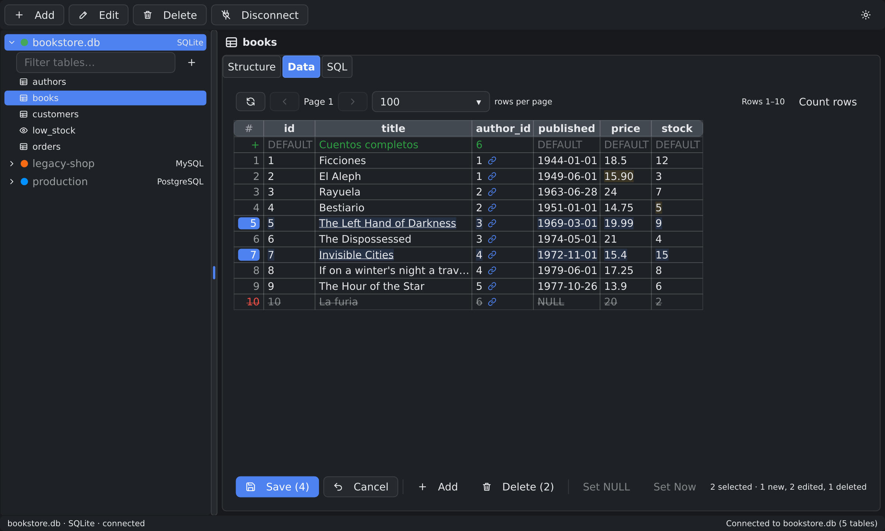
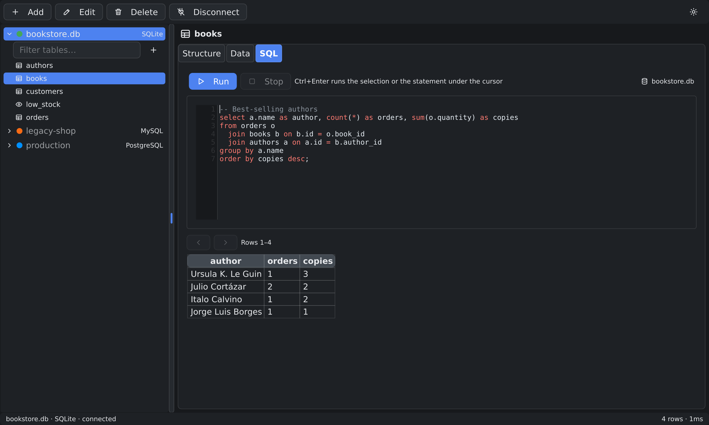
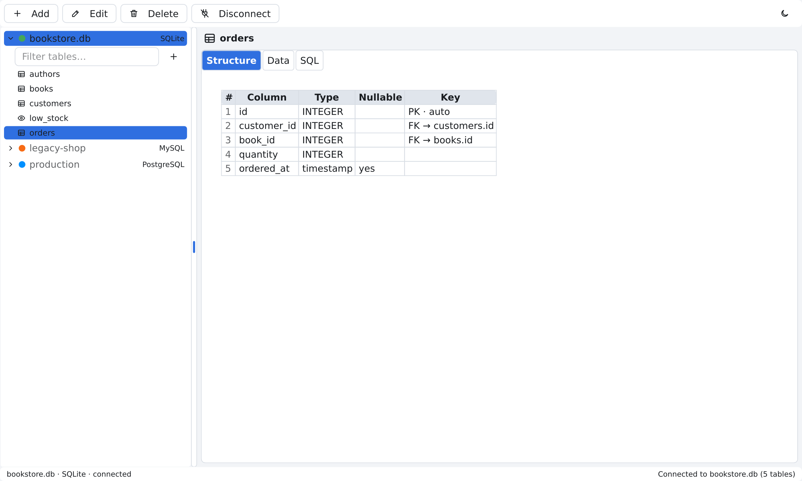
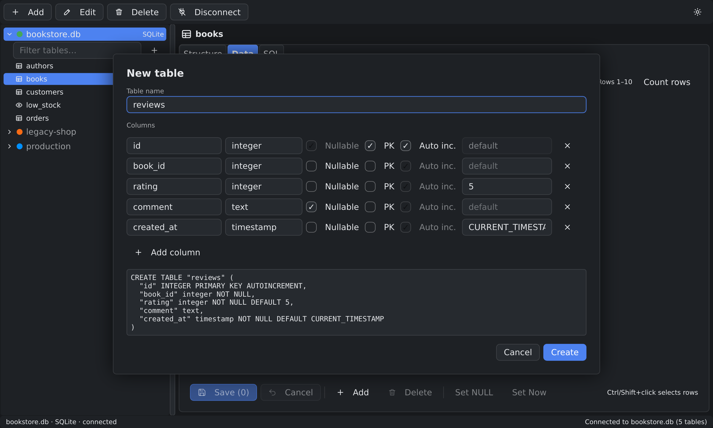
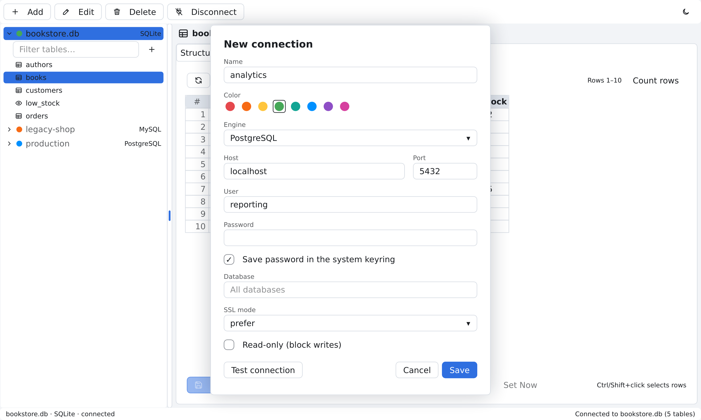

# Anvil

A free, cross-platform desktop database manager written in Go with
[go-gui](https://github.com/go-gui-org/go-gui). Connect to a database, explore its tables, run SQL and
edit data safely: every change is previewed as SQL and saved in a single transaction.



|              |                                                     |
|--------------|-----------------------------------------------------|
| **Engines**  | SQLite, PostgreSQL, MySQL / MariaDB, SQL Server, Oracle (12c+) |
| **Platforms**| Linux (X11 / Wayland), Windows, macOS               |
| **License**  | MIT                                                 |

> Anvil is under active development. The full specification and the status of each milestone are in
> [`SPEC.md`](SPEC.md).

## Screenshots

| SQL editor | Table structure |
|------------|-----------------|
|  |  |
| **New table** | **New connection** |
|  |  |

## Features

### Connections

- Create, edit, delete and test connections (**Test connection**), each with a color to spot it in the
  sidebar.
- **Passwords in the system keyring** (service `ANVIL-DBM`). Without a keyring the password is not stored
  and is asked for on connect.
- **SSL/TLS** for PostgreSQL and MySQL: mode, CA, client certificate and key. Encryption mode for SQL
  Server (`false` encrypts only the login, `trust` skips certificate verification) and SSL for Oracle.
- **All databases**: leave the database empty in PostgreSQL, MySQL or SQL Server and every database on the
  server is listed; each one expands to show its tables.
- **SQL Server**: named instances as `host\INSTANCE`. **Oracle**: the database is the service name
  (required) and the tables shown are those of the user's schema.
- **Read-only** connections: the grid cannot be edited, the SQL editor rejects writes and, in PostgreSQL and
  MySQL, the session is read-only on the server too.

### Browse

- Sidebar with the tables and views of each database, with a text filter.
- Three tabs per table:
  - **Structure**: columns with type, nullable, PK / auto-increment and foreign keys (`FK → table.column`).
  - **Data**: paginated grid (keyset or `OFFSET`), 20 to 500 rows per page, on-demand `COUNT(*)`, dimmed
    `NULL` and summarized BLOBs.
  - **SQL**: an editor with syntax highlighting that runs against the table's database.
- **Foreign key navigation**: foreign key cells have a link that opens the referenced table filtered to
  that row; the back button returns to where you were.

### Edit data

- Click a cell to edit it; **Ctrl/Cmd+click** and **Shift+click** select several rows.
- Dates and times are picked with a calendar and a time field, never typed by hand.
- The bar below the grid has **Save (N)**, **Cancel** | **Add**, **Delete** | **Set NULL**, **Set Now**.
- Changes stay **pending** (edited cells highlighted, new rows marked `+`, deleted rows struck through)
  until you save. Saving shows the SQL first and runs everything in **one transaction**: if a statement
  fails nothing is saved and the error names the change that failed.
- Every `UPDATE` / `DELETE` must affect exactly one row, so tables without a primary key are safe too
  (you are warned before editing them).
- Changing page, leaving the table, disconnecting or closing the window with unsaved changes asks first.

### Create tables and databases

- **New table** (the `+` next to the table filter): name, type, nullable, primary key, auto-increment and
  default per column, with a live preview of the `CREATE TABLE` for the engine.
- **New database** on PostgreSQL, MySQL and SQL Server connections without a database.
- **New…** in the SQLite connection form creates an empty database file.

### Run SQL

- **Ctrl+Enter** runs the selection or, without a selection, the statement under the cursor.
- Several statements run in order in the same session; the last result is shown.
- Runs in the background with a **Stop** button; results are paginated.
- Warnings before an `UPDATE` / `DELETE` without `WHERE` or DML outside a transaction.
- Query history stored locally.

### And

- Light and dark theme, remembered across sessions.
- Pure Go SQLite: no CGO needed on Linux and Windows.

### Coming up

- Autocompletion of keywords, tables and columns; a history panel with search.
- Export to CSV and JSON.
- Packages for AUR, Homebrew and winget.

## Install

### Download

Pre-built binaries for every tagged version are on the
[Releases](https://github.com/Watts-Argentina/anvil/releases) page (`.tar.gz` for Linux and macOS, `.zip`
for Windows), with a `SHA256SUMS` file.

### Build from source

Requirements:

- [Go](https://go.dev/dl/) 1.27 or later.
- **Linux / Windows**: nothing else; the build is CGO-free (`CGO_ENABLED=0`).
- **macOS**: CGO and the Xcode command line tools, because go-gui's Metal backend uses Objective-C. Build
  on a Mac: a `CGO_ENABLED=0` macOS binary compiles but cannot open a window.
- Optional: a system keyring (Secret Service on Linux, Keychain on macOS, Credential Manager on Windows)
  to store passwords.

```sh
git clone https://github.com/Watts-Argentina/anvil.git
cd anvil
go run .
```

The `makefile` has the usual targets:

| Command                   | Result                                              |
|---------------------------|-----------------------------------------------------|
| `make run`                | Runs Anvil from source                              |
| `make build`              | `dist/anvil` for the current platform               |
| `make build-linux-amd64`  | One platform (`build-<os>-<arch>`)                  |
| `make release`            | Every platform plus `dist/SHA256SUMS`               |

`anvil --version` prints the version stamped at build time.

## Keyboard and mouse

| Where       | Shortcut                     | Action                                           |
|-------------|------------------------------|--------------------------------------------------|
| SQL editor  | **Ctrl+Enter**               | Run the selection or the statement under the cursor |
| Data grid   | **Click**                    | Select the row and edit the cell                 |
| Data grid   | **Ctrl/Cmd+click**           | Add or remove a row from the selection           |
| Data grid   | **Shift+click**              | Select a range of rows                           |
| Cell editor | **Enter** / **Esc**          | Keep / discard the value                         |
| Cell editor | **Ctrl+0**                   | Set NULL                                         |

## Local configuration

Connections, preferences and history are stored in a SQLite database in the user's configuration
directory:

| System  | Path                                              |
|---------|---------------------------------------------------|
| Linux   | `~/.config/anvil/anvil.db`                        |
| macOS   | `~/Library/Application Support/anvil/anvil.db`    |
| Windows | `%AppData%\anvil\anvil.db`                        |

Passwords never go to that database: they are kept in the system keyring or asked for on connect.

## Development

### Tests

```sh
go vet ./...
go test ./...
```

Tests against real PostgreSQL, MySQL, SQL Server and Oracle servers are skipped unless these variables are
set (five space-separated fields; for Oracle the last one is the service). With Docker, throwaway servers
are enough:

```sh
docker run -d --rm --name anvil-pg -e POSTGRES_PASSWORD=anvil -p 127.0.0.1:55432:5432 postgres:18-alpine
docker run -d --rm --name anvil-my -e MYSQL_ROOT_PASSWORD=anvil -e MYSQL_DATABASE=anvil -p 127.0.0.1:53306:3306 mysql:8.4
docker run -d --rm --name anvil-ms -e ACCEPT_EULA=Y -e MSSQL_SA_PASSWORD=Anvil_Test_1 -p 127.0.0.1:51433:1433 mcr.microsoft.com/mssql/server:2022-latest
docker run -d --rm --name anvil-ora -e ORACLE_PASSWORD=anvil -e APP_USER=anvil -e APP_USER_PASSWORD=anvil -p 127.0.0.1:51521:1521 gvenzl/oracle-free:23-slim
# Once SQL Server is up, create the test database:
docker exec anvil-ms /opt/mssql-tools18/bin/sqlcmd -C -U sa -P Anvil_Test_1 -Q "CREATE DATABASE anvil"
ANVIL_TEST_PG="127.0.0.1 55432 postgres anvil postgres" \
ANVIL_TEST_MYSQL="127.0.0.1 53306 root anvil anvil" \
ANVIL_TEST_MSSQL="127.0.0.1 51433 sa Anvil_Test_1 anvil" \
ANVIL_TEST_ORACLE="127.0.0.1 51521 anvil anvil FREEPDB1" go test -count=1 ./...
docker rm -f anvil-pg anvil-my anvil-ms anvil-ora
```

UI tests run headless with go-gui's software renderer. They check for duplicate IDs, missing handlers and
widgets that overflow their dialog or the window.

### Screenshots

`ANVIL_SCREENSHOTS=<dir> go test ./ui/` saves a PNG of every tested screen. The README screenshots are
generated from a demo database and can be refreshed with:

```sh
ANVIL_README_SHOTS=docs/screenshots go test ./ui/ -run TestReadmeScreenshots -count=1
```

### Project layout

```
main.go
ui/                   go-gui views (layout, sidebar, tabs, grid and its editing, SQL editor, dialogs)
ui/components/        reusable components
internal/connections  connection CRUD + keyring
internal/drivers      per-engine abstraction: connection, dialect, metadata, SQL split and analysis
internal/session      open connections (one pool per database)
internal/query        execution, pagination (with the FK filter) and cancellation
internal/editing      pending changes, validation, DML and the save transaction
internal/schema       DDL to create tables and databases
internal/history      query history
internal/settings     local preferences
internal/storage      opening and migrating the local database
models/               GORM models for the local configuration
pkg/appErrors         errors with a title and description for the UI
assets/               embedded SVG icons
docs/screenshots/     README screenshots
agents/skills/        guides for coding agents working on the repo
```

### Releases

Pushing a `v*` tag runs [GoReleaser](https://goreleaser.com) on GitHub Actions
(`.github/workflows/release.yml`, `.goreleaser.yaml`): it runs the tests, builds every platform and
publishes the archives and checksums. Tags like `v0.5.0-beta` are marked as pre-releases.

## Contributing

1. Read [`SPEC.md`](SPEC.md): it defines the scope, the design decisions and the status of each milestone.
2. Open an issue before large changes.
3. Make sure `gofmt`, `go vet ./...` and `go test ./...` pass before sending the PR.

## License

Distributed under the [MIT](LICENSE) license.
